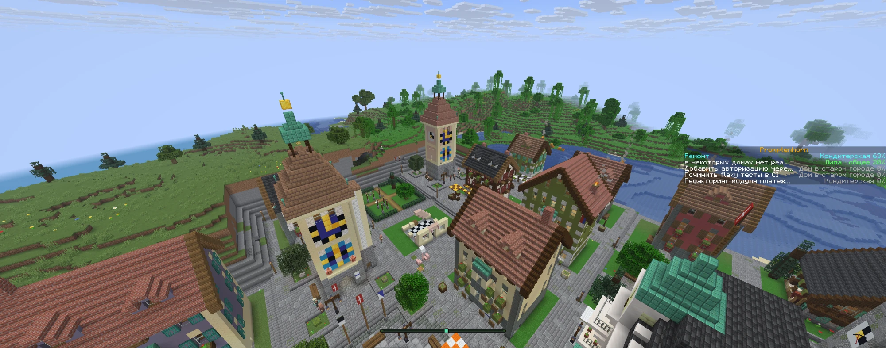
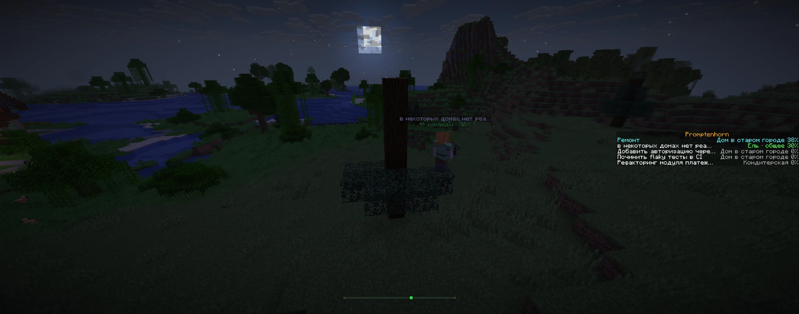

[English](README.md) · [Русский](README.ru.md) · [Español](README.es.md) · [Deutsch](README.de.md) · [Français](README.fr.md) · **Italiano** · [Português](README.pt.md) · [中文](README.zh.md) · [日本語](README.ja.md)

# Promptenhorn

*Un Cervino costruito con i prompt.* Nel gioco il mondo si chiama Claude Alps.

Ogni chat di Claude Code diventa un costruttore in Minecraft. Mentre Claude lavora, il costruttore (Steve, Alex, Kai…) tira su una casa. Le case crescono fino a diventare una cittadina svizzera: prima un villaggio di chalet, poi un centro storico con portici, una chiesa e un albergo, poi quartieri moderni.

Non costa nessun token: gli hook sono semplici comandi locali. Non scrivono nulla nella chat, non prendono decisioni al posto di Claude e girano in background (`async`), quindi Claude non li aspetta mai.





## Come funziona

```
Claude Code ──hook──▶ hooks/alps-hook.mjs ──HTTP──▶ bridge/bridge.mjs ──RCON──▶ Minecraft (Paper 1.21.11)
                                                        │
                                                        ├── http://127.0.0.1:7777/     pagina delle impostazioni
                                                        └── http://127.0.0.1:7777/map  mappa della città in tempo reale
```

| Evento di Claude Code | Cosa succede nel mondo |
|---|---|
| Nuova chat | Compare un costruttore |
| Il tuo messaggio | Il costruttore riceve un nome (le prime parole del tuo prompt) e un lotto |
| Claude modifica file, esegue comandi | La costruzione prosegue (~3 blocchi/s) più un bonus per ogni azione |
| Claude finisce la risposta | Il costruttore aspetta vicino alla casa; dopo 30 minuti si addormenta |
| Casa finita | Fuochi d'artificio, un abitante del villaggio si trasferisce, il costruttore va al lotto successivo |
| Chat chiusa | Il costruttore se ne va; la chat successiva completa le case lasciate a metà |

- Un progetto (cartella) = un quartiere. La città sorge in una valle alpina tra le montagne.
- Una barra laterale a destra elenca ogni chat attiva con il suo avanzamento in percentuale.
- Quando entri nel gioco, la chat mostra l'elenco dei quartieri (clicca per teletrasportarti) e un link alle impostazioni.

## Privacy

L'hook riduce ogni evento a piccoli segnali e invia al bridge solo quelli: il nome dello strumento, il tipo di notifica, "era un test ed è fallito", "era un commit". I comandi, il contenuto dei file, l'output degli strumenti e le risposte di Claude non lasciano mai l'hook. L'unica eccezione sono le prime parole del primo messaggio: diventano il nome del costruttore. Il testo del prompt finisce nel libro della cronaca solo se l'opzione "Testo del prompt nella cronaca" è attiva (in tutti i preset è disattivata).

## Per iniziare

Servono Java 21+ e Node.js 18+.

1. Installa gli hook una volta sola:
   ```
   node install-hooks.mjs
   ```
   Lo script aggiunge gli hook a `~/.claude/settings.json` e salva un backup accanto. Gli altri hook non vengono toccati, e rieseguirlo non crea problemi. Solo le nuove chat caricano gli hook.
2. Metti un server Paper 1.21.11 in `server/paper.jar`. Il repository non include file del gioco: scarichi il server tu stesso e, avviandolo, accetti l'[EULA di Minecraft](https://aka.ms/MinecraftEULA) (vedi [NOTICE.md](NOTICE.md)).
3. Avvia il server e il bridge: doppio clic su `start.cmd` (si aprono due finestre ridotte a icona).
4. In TLauncher scegli la versione **1.21.11** → "Multigiocatore" → server `localhost`.
5. Lavora con Claude come al solito e guarda la città crescere. Vola in giro in modalità creativa o con `/gamemode spectator`.

Per provarlo senza chat reali: con il bridge in esecuzione, lancia `node demo.mjs 3`.

## Mappa in tempo reale

**http://127.0.0.1:7777/map** mostra la città direttamente nel browser: lotti, quartieri e costruttori come punti in movimento, insieme a quello che ogni chat sta facendo in quel momento (modifica, esecuzione di comandi, attesa del tuo permesso, sonno…). I pulsanti "Teletrasporto" e "Segui" ti portano da un costruttore nel gioco (devi essere sul server). La mappa legge solo lo stato del bridge: niente file del mondo, niente mod lato client. In cima alla pagina delle impostazioni c'è un link alla mappa.

## Lingua

Per impostazione predefinita tutto ciò che vedi nel mondo e sulle pagine del bridge è in inglese. La lingua si cambia al volo, senza riavvio: dal menu a tendina della pagina delle impostazioni o dal terminale:

```
node configure.mjs language ru     # en | ru | es | de | fr | it | pt | zh | ja
```

Lingue supportate: English, Русский, Español, Deutsch, Français, Italiano, Português, 中文 e 日本語. Il valore è salvato in `config.json` come `"language"`; ogni stringa non ancora tradotta viene mostrata in inglese. Le insegne svizzere sugli edifici (ad es. `BAECKEREI`) restano di proposito in svizzero tedesco. Come funziona la localizzazione: `docs/i18n.md`.

## Impostazioni: preset e funzionalità

Apri **http://127.0.0.1:7777/** (quando entri c'è anche un link "[impostazioni]" nella chat di gioco). Le modifiche si applicano subito, senza riavvio, e vengono salvate in `config.json` (`preset` + `features`).

| Preset | Cosa è attivo |
|---|---|
| Minimale | Costruttori e case, come nella prima versione |
| Base (predefinito) | Funzionalità testate che non fanno rumore |
| Max | Tutte le funzionalità testate |

Oltre al preset puoi attivare o disattivare qualsiasi funzionalità. Le funzionalità contrassegnate come "sperimentali" sono scritte ma non ancora del tutto testate nel mondo: non fanno parte di nessun preset e si possono attivare solo a mano. Lo stato di ogni funzionalità è in `docs/roadmap.md`.

Lo stesso dal terminale:

```
node configure.mjs                 # preset e tutte le funzionalità
node configure.mjs basic           # scegli un preset (minimal | basic | max)
node configure.mjs tests on        # attiva una funzionalità in aggiunta al preset
node configure.mjs tests reset     # torna a quanto previsto dal preset
node configure.mjs language de     # cambia la lingua
```

Un bridge in esecuzione recepisce le modifiche a `config.json` entro un paio di secondi.

### Funzionalità

| Gruppo | Funzionalità |
|---|---|
| Claude al lavoro | Il costruttore ti chiama (in attesa di un permesso o di una risposta: "!", una campana, una barra rossa), barra gialla "in attesa di un compito", test (scintille, una bandiera, una nuvola di pioggia), commit = campana, push = autopostale PostAuto, PR = bandiera cantonale, ricerca web = allay postino, compattazione = pausa caffè, limite API = temporale in montagna, modalità piano = architetto |
| Costruttori | Stato sotto il nome, attrezzo in mano, apprendisti subagenti |
| Città | Giorno e notte reali, luci alle finestre, fumo dal camino, economia delle chat, **ristrutturazione invece di demolizione**, abitanti per professione, impalcature, la Zytglogge batte le ore |
| Progressi | Progressi, cronaca delle case, rango dell'insediamento (Weiler → Dorf → Städtli → Stadt), franchi per i token (un cartello "Kasse: CHF …"), barra di avanzamento del Cervino |
| Informazioni | Municipio (una finestra con tutti i costruttori), costruttori sulla barra di localizzazione, "mentre eri via" |
| Easter egg | Corno delle Alpi quando una casa è finita, piccoli dettagli (TNT su rm -rf, elmetto in base al modello), orologi FFS, 1° agosto e Natale |
| Privacy | Testo del prompt nella cronaca (solo manuale) |

La cronaca delle case aggiunge alla pagina delle impostazioni una sezione "Cronaca della città": ogni edificio con il suo progetto, i suoi costruttori e la data, un filtro per progetto, una ricerca e il teletrasporto alla casa.

### Parametri

Nella stessa pagina puoi impostare quante azioni servono a una chat prima di avere la propria casa e prima delle fasi successive (economia delle chat), la velocità di costruzione e quella di ristrutturazione. Altri valori si impostano in `config.json`:

```json
{
  "preset": "basic",
  "features": { "status": true },
  "language": "en",
  "blocksPerSecond": 3,
  "toolBurst": { "Edit": 10, "Write": 12, "Bash": 5, "default": 3 },
  "houseAfterActions": 20,
  "stageActions": [80, 200],
  "idleAfterMinutes": 10,
  "sleepAfterMinutes": 30,
  "retireAfterHours": 72,
  "renovateBlocksPerSecond": 2,
  "maxVillagersPerDistrict": 12,
  "villagerAI": false,
  "scratchDistrictName": "Alpweide"
}
```

Le chat senza cartella di progetto costruiscono il quartiere comune "Alpweide". Per impostazione predefinita gli abitanti stanno fermi (`villagerAI: false`) e ce ne sono al massimo 12 per quartiere: un centinaio di abitanti che vagano in giro pesa parecchio sul server.

## Ristrutturazione invece di demolizione

Quando i generatori di edifici cambiano, la città non viene ricostruita da zero. Il bridge ricorda quale versione ha costruito ogni lotto (l'archivio delle versioni è in `bridge/archive/`) e ripara le case tramite diff: rimuove ciò che non c'è più, piazza ciò che è nuovo e lascia stare i blocchi che coincidono.

- Una casa costruita a metà viene completata secondo il nuovo progetto.
- Le case finite, le piazze di quartiere e la piazza principale vengono riparate da una squadra: 2 blocchi/s finché almeno una chat sta lavorando, e in più ogni costruttore del quartiere sveglio e libero viene a dare una mano. La barra laterale mostra una riga come "Ristrutturazione: Chalet 40%" e, quando un quartiere è finito, compare un messaggio nella chat.
- Lanterne, giunture tra i lotti e pavimentazione hanno versioni separate e vengono aggiornate allo stesso modo.

Dettagli per chi scrive generatori: `docs/generator-contract.md`.

## Progressi e municipio

Per i progressi e il pulsante "Municipio" nel menu di pausa, il bridge installa da sé il pacchetto dati `datapack/promptenhorn` in `server/world/datapacks/` e ricarica i pacchetti dati. Il pulsante nel menu di pausa compare dopo il successivo riavvio del server (i dialoghi vengono caricati solo all'avvio); il link "[Municipio]" nella chat funziona subito. Dalla finestra del municipio si può anche aprire la mappa in tempo reale nel browser.

## Arresto e disinstallazione

- Per fermare tutto: scrivi `stop` nella finestra del server e chiudi la finestra del bridge.
- Se il bridge non è in esecuzione, l'hook trova un file heartbeat scaduto ed esce subito.
- Per rimuovere gli hook: `node install-hooks.mjs --uninstall`.

## File

| Percorso | Che cos'è |
|---|---|
| `bridge/bridge.mjs` | Il demone: eventi, sessioni, lotti e oggetti, costruzione, ristrutturazione |
| `bridge/features/*.mjs` | Le funzionalità che attivi nelle impostazioni (registro e dispatcher in `index.mjs`) |
| `bridge/settings.mjs`, `bridge/settings-page.mjs` | Preset, interruttori, parametri; la pagina delle impostazioni e la sua API |
| `bridge/map-page.mjs` | Mappa della città in tempo reale (`/map`) |
| `bridge/i18n.mjs`, `locales/` | Localizzazione: `t()` e cataloghi di stringhe per lingua (`en.json` è la fonte) |
| `bridge/generators.mjs`, `bridge/archive/` | Versioni dei generatori e il loro archivio |
| `bridge/renovate.mjs` | Ristrutturazione tramite diff |
| `bridge/fx.mjs` | Coda degli effetti con un budget RCON per tick |
| `bridge/plotmeta.mjs` | Campane, camini, porte, finestre, quadranti d'orologio individuati in un progetto |
| `bridge/smallforms.mjs` | Panchine, alberi, aiuole, fontane, il parco, il belvedere |
| `bridge/buildings.mjs`, `bridge/blueprint.mjs` | Generatori di edifici (assemblati da `.dev/parts`) |
| `hooks/alps-hook.mjs` | L'hook di Claude Code |
| `install-hooks.mjs`, `configure.mjs` | Installer degli hook; impostazioni dal terminale |
| `datapack/` | Pacchetto dati per progressi e municipio (`node datapack/build.mjs` lo ricostruisce) |
| `bots/` | Esperimento: veri bot costruttori Mineflayer (`package.json` separato) |
| `docs/` | Contratto dei generatori, standard edilizi, localizzazione, roadmap |
| `server/` | Paper 1.21.11: solo localhost, modalità offline, pacifica, creativa |
| `state.json` | Lo stato della città |

Per ricominciare la città da capo: ferma tutto, cancella `server/world*` e `state.json`.

## Licenza

- [LICENSE](LICENSE) — MIT, © 2026 linkartemy.
- [NOTICE.md](NOTICE.md) — un progetto di fan indipendente, non affiliato a Mojang, Microsoft o Anthropic; nessun file del gioco viene ridistribuito, e l'EULA di Minecraft la accetti tu stesso.
