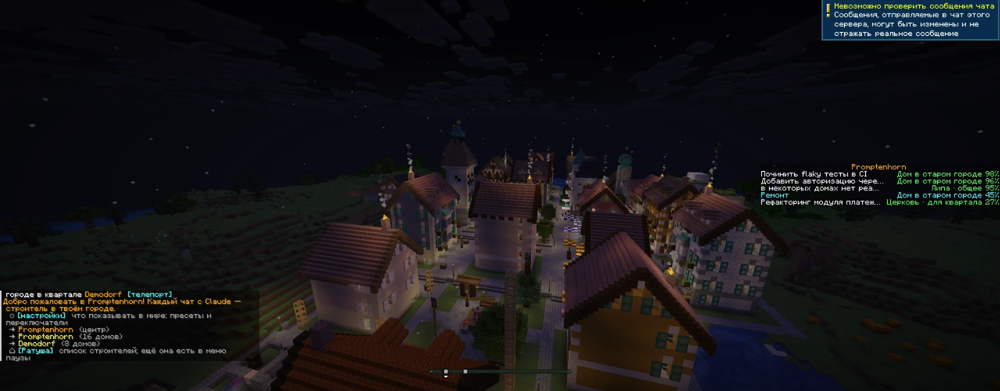
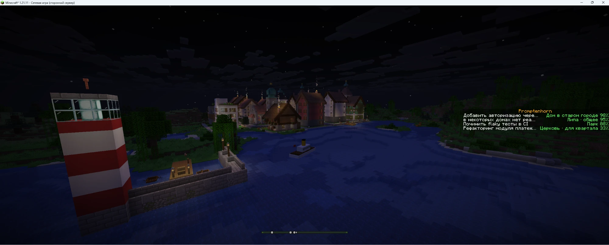
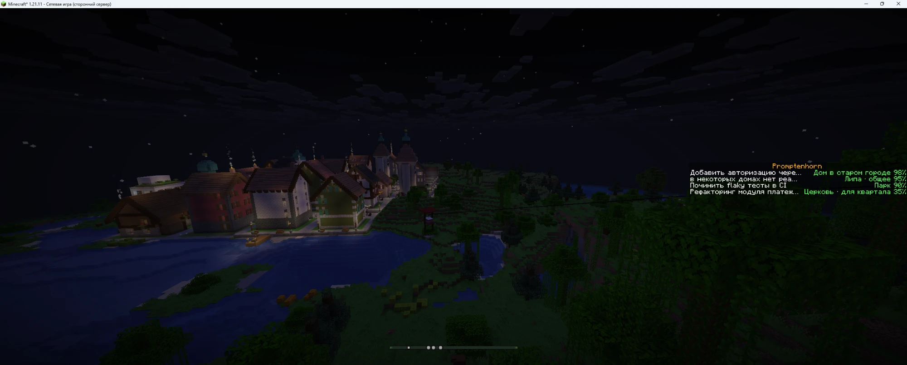
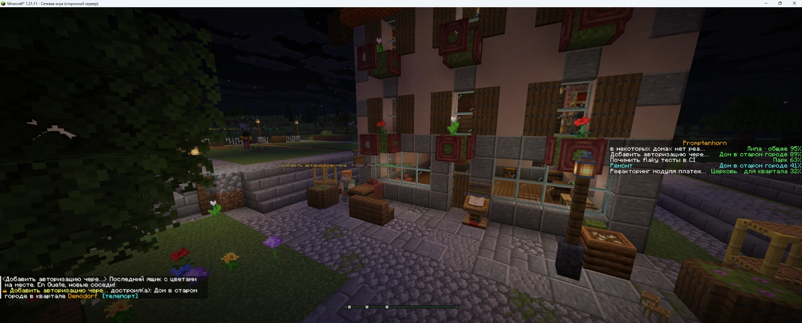
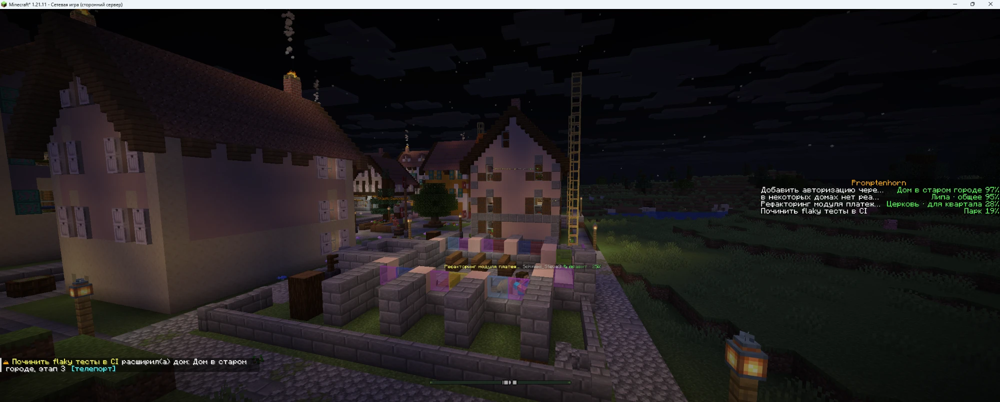
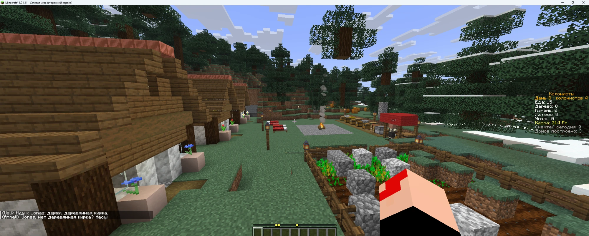
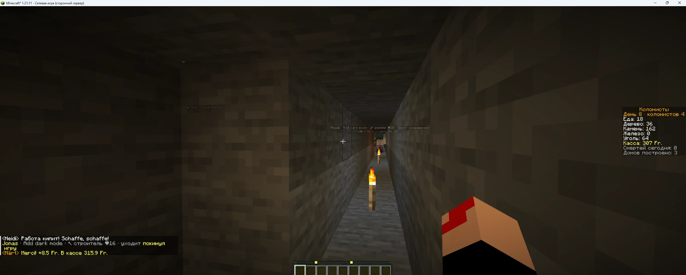

[English](README.md) · [Русский](README.ru.md) · [Español](README.es.md) · [Deutsch](README.de.md) · [Français](README.fr.md) · [Italiano](README.it.md) · [Português](README.pt.md) · **中文** · [日本語](README.ja.md)

# Promptenhorn

*一座用提示词堆成的马特洪峰。* 在游戏里，这个世界叫作 Claude Alps。

每一个 Claude Code 对话都会变成 Minecraft 里的一名建造者。Claude 工作时，建造者（Steve、Alex、Kai……）就在盖房子。房子越来越多，渐渐长成一座瑞士小镇：先是一个木屋小村，然后是带拱廊、教堂和酒店的老城，最后是现代街区。

它不消耗任何 token：钩子只是普通的本地命令。它们不会向对话输出任何内容，不替 Claude 做任何决定，并且在后台运行（`async`），所以 Claude 从不需要等待它们。


<details open><summary><b>画廊</b></summary>

<table>
<tr><td width="50%"><br><sub>夜晚的小镇：窗户亮灯，烟囱冒烟</sub></td><td width="50%"><br><sub>灯塔、港口和湖上的蒸汽船</sub></td></tr>
<tr><td width="50%"><br><sub>湖畔街区和通往山顶的缆车</sub></td><td width="50%"><br><sub>建成的房子：花箱、编年史讲台和一个建筑机器人</sub></td></tr>
<tr><td width="50%"><br><sub>一栋房子正在扩建到第三阶段，搭着脚手架</sub></td><td width="50%"><br><sub>建筑者为街区的公共工程种下一棵云杉</sub></td></tr>
<tr><td width="50%"><br><sub><b>殖民者模式</b>：拥有菜园、仓库和市场的生存殖民地</sub></td><td width="50%"><br><sub>殖民者挖掘点着火把的矿道；右侧是殖民地库存</sub></td></tr>
</table>

</details>

## 工作原理

```
Claude Code ──hook──▶ hooks/alps-hook.mjs ──HTTP──▶ bridge/bridge.mjs ──RCON──▶ Minecraft (Paper 1.21.11)
                                                        │
                                                        ├── http://127.0.0.1:7777/     设置页面
                                                        └── http://127.0.0.1:7777/map  实时小镇地图
```

| Claude Code 事件 | 世界中发生的事 |
|---|---|
| 新对话 | 出现一名建造者 |
| 你发送消息 | 建造者获得名字（你提示词的前几个词）和一块地皮 |
| Claude 编辑文件、运行命令 | 施工继续（约 3 方块/秒），每个操作还有额外加成 |
| Claude 完成回复 | 建造者在房子旁等待；30 分钟后去睡觉 |
| 房子完工 | 放烟花，一位村民搬进来，建造者前往下一块地皮 |
| 对话关闭 | 建造者离开；下一个对话会把盖到一半的房子完成 |

- 一个项目（文件夹）= 一个街区。小镇坐落在群山之间的一条阿尔卑斯山谷里。
- 右侧的侧边栏列出所有活跃对话及其完成百分比。
- 进入游戏时，聊天栏会显示街区列表（点击即可传送）和设置页面的链接。

## 隐私

钩子把每个事件压缩成很小的信号，只把这些信号发送给 bridge：工具名称、通知类型、“这是一次测试且失败了”、“这是一次 commit”。命令、文件内容、工具输出和 Claude 的回复都不会离开钩子。唯一的例外是第一条消息的前几个词：它们会成为建造者的名字。只有在开启“编年史中的提示词文本”选项时，提示词文本才会写入编年史书（所有预设中该选项都是关闭的）。

## 快速开始

你需要 Java 21+ 和 Node.js 18+。

1. 安装钩子（只需一次）：
   ```
   node install-hooks.mjs
   ```
   该脚本会把钩子添加到 `~/.claude/settings.json`，并在旁边写一份备份。其他钩子不受影响，重复运行也是安全的。只有新对话才会加载这些钩子。
2. 把 Paper 1.21.11 服务器放到 `server/paper.jar`。仓库不包含任何游戏文件：服务器需要你自己下载，运行它即表示你接受 [Minecraft EULA](https://aka.ms/MinecraftEULA)（参见 [NOTICE.md](NOTICE.md)）。
3. 启动服务器和 bridge：双击 `start.cmd`（会打开两个最小化的窗口）。
4. 在 TLauncher 中选择版本 **1.21.11** → “多人游戏” → 服务器 `localhost`。
5. 像平常一样使用 Claude，看着小镇成长。可以在创造模式下飞行，或使用 `/gamemode spectator` 四处观看。

不想用真实对话也能试玩：在 bridge 运行时执行 `node demo.mjs 3`。

## 实时地图

**http://127.0.0.1:7777/map** 直接在浏览器中显示小镇：地皮、街区，以及作为移动圆点的建造者，同时还显示每个对话此刻在做什么（编辑、运行命令、等待你的授权、睡觉……）。“传送”和“跟随”按钮会把你带到游戏中的建造者身边（你需要在服务器上）。地图只读取 bridge 的状态：不读世界文件，也不需要客户端模组。设置页面顶部有它的链接。

## 语言

默认情况下，你在世界中和 bridge 页面上看到的一切都是英文。语言可以实时切换，无需重启：使用设置页面上的下拉菜单，或者在终端中执行：

```
node configure.mjs language ru     # en | ru | es | de | fr | it | pt | zh | ja
```

支持的语言：English、Русский、Español、Deutsch、Français、Italiano、Português、中文和日本語。该值以 `"language"` 保存在 `config.json` 中；尚未翻译的字符串会以英文显示。建筑上的瑞士店铺招牌（例如 `BAECKEREI`）特意保留为瑞士德语。本地化的工作方式见：`docs/i18n.md`。

## 设置：预设与功能

打开 **http://127.0.0.1:7777/**（进入游戏时，聊天栏里也有一个“[settings]”链接）。更改会立即生效，无需重启，并保存到 `config.json`（`preset` + `features`）。

| 预设 | 开启的内容 |
|---|---|
| Minimal | 建造者和房子，和最初版本一样 |
| Basic（默认） | 经过测试且不吵闹的功能 |
| Max | 所有经过测试的功能 |

在预设之上，你可以单独开启或关闭任何功能。标记为“实验性”的功能已经写好，但尚未在世界中充分测试：它们不属于任何预设，只能手动开启。每个功能的状态见 `docs/roadmap.md`。

在终端中也可以做同样的事：

```
node configure.mjs                 # 预设及所有功能
node configure.mjs basic           # 选择预设（minimal | basic | max）
node configure.mjs tests on        # 在预设之上单独开启一个功能
node configure.mjs tests reset     # 恢复为预设的设定
node configure.mjs language de     # 更改语言
```

正在运行的 bridge 会在几秒内读取 `config.json` 的更改。

### 功能

| 分组 | 功能 |
|---|---|
| 工作中的 Claude | 建造者呼叫你（等待授权或回答时：“!”、铃声、红色进度条），黄色“等待任务”进度条，测试（火花、旗帜、雨云），commit = 铃声，push = PostAuto（瑞士邮政巴士），PR = 州旗，网页搜索 = 送信的悦灵，压缩上下文 = 咖啡休息，API 限额 = 山间雷暴，计划模式 = 建筑师 |
| 建造者 | 名字下方的状态，手中的工具，子代理学徒 |
| 小镇 | 真实的昼夜，窗户里的灯光，烟囱冒烟，对话经济，**翻新而非拆除**，按职业分配的村民，脚手架，Zytglogge（伯尔尼钟楼）整点报时 |
| 进度 | 进度成就，房屋编年史，聚落等级（Weiler（小村落）→ Dorf（村庄）→ Städtli（小城）→ Stadt（城市）），token 换法郎（一块“Kasse: CHF …”（收银处：瑞士法郎）告示牌），马特洪峰进度条 |
| 信息 | 镇政厅（一个列出所有建造者的窗口），定位栏上的建造者，“你不在时发生了什么” |
| 彩蛋 | 房子完工时吹响阿尔卑斯长号，各种小细节（rm -rf 时出现 TNT，按模型区分的安全帽），SBB（瑞士联邦铁路）时钟，8 月 1 日（瑞士国庆日）和圣诞节 |
| 隐私 | 编年史中的提示词文本（仅限手动开启） |

房屋编年史会在设置页面上添加一个“小镇编年史”部分：列出每座建筑及其项目、建造者和日期，支持按项目筛选、搜索以及传送到房屋。

### 参数

在同一页面上，你可以设置一个对话需要多少次操作才能拥有自己的房子以及进入后续阶段（对话经济），还可以设置建造速度和翻新速度。其他值可以在 `config.json` 中设置：

```json
{
  "preset": "basic",
  "features": { "status": true },
  "language": "en",
  "blocksPerSecond": 3,
  "toolBurst": { "Edit": 10, "Write": 12, "Bash": 5, "default": 3 },
  "houseAfterActions": 20,
  "stageActions": [80, 200],
  "idleAfterMinutes": 10,
  "sleepAfterMinutes": 30,
  "retireAfterHours": 72,
  "renovateBlocksPerSecond": 2,
  "maxVillagersPerDistrict": 12,
  "villagerAI": false,
  "scratchDistrictName": "Alpweide"
}
```

没有项目文件夹的对话会共同建造“Alpweide”街区。默认情况下村民站着不动（`villagerAI: false`），且每个街区最多 12 名：上百个四处走动的村民会给服务器带来明显的负担。

## 翻新而非拆除

当建筑生成器发生变化时，小镇不会从零重建。bridge 会记住每块地皮是由哪个版本建造的（版本存档位于 `bridge/archive/`），并按差异修缮房屋：移除已经不存在的部分，放置新增的部分，保留相同的方块不动。

- 盖到一半的房子会按新蓝图完成。
- 已完工的房子、街区广场和主广场由施工队修缮：只要至少有一个对话在工作，速度就是 2 方块/秒，此外该街区任何醒着且空闲的建造者都会来帮忙。侧边栏会显示类似“Renovation: Chalet 40%”的一行，某个街区完成后，聊天栏会出现一条消息。
- 路灯、地皮之间的接缝和路面单独进行版本管理，并以同样的方式更新。

面向生成器作者的详细说明：`docs/generator-contract.md`。

## 进度成就与镇政厅

为了提供进度成就和暂停菜单中的“镇政厅”按钮，bridge 会自行把 `datapack/promptenhorn` 数据包安装到 `server/world/datapacks/` 并重新加载数据包。暂停菜单按钮会在下次服务器重启后出现（对话框只在启动时加载）；聊天栏中的“[Town hall]”链接则立即可用。镇政厅窗口还可以在浏览器中打开实时地图。

## 按电脑调优

`node tools/tune.mjs` 会测量电脑（内存、CPU、正在运行的程序），并以只读方式测量运行中的服务器（TPS、MSPT、区块、实体），然后给出方案：启动脚本的 Java 内存与参数、`view-distance` / `simulation-distance`、Paper/Spigot/Bukkit 的 tick 优化，以及桥接的上限（`builderBotsMax`、`colonistsMax`、翻新速度、生活密度）。只有加上 `--apply` 才会写入，写入前每个文件都会备份到 `backups/tune/<时间>/`；之后重启服务器和桥接。

```
node tools/tune.mjs            # dry run
node tools/tune.mjs --apply    # write the plan, then restart
```

参考：8 GB：`-Xmx1536M`，视距 6。16 GB：`-Xmx2560M`，视距 12，最多 4 个真实建造者和 3 个殖民者。32 GB：`-Xmx4G`，视距 16。要保留自己的值：在 `config.json` 中写 `"tuning": { "lock": ["server.view-distance"] }`。详情（英文）：[docs/performance.md](docs/performance.md)。

## 停止与卸载

- 停止：在服务器窗口中输入 `stop`，然后关闭 bridge 窗口。
- 如果 bridge 没有运行，钩子会发现心跳文件已过期并立即退出。
- 移除钩子：`node install-hooks.mjs --uninstall`。

## 文件

| 路径 | 说明 |
|---|---|
| `bridge/bridge.mjs` | 守护进程：事件、会话、地皮与物体、施工、翻新 |
| `bridge/features/*.mjs` | 可在设置中开关的功能（注册表和调度器在 `index.mjs` 中） |
| `bridge/settings.mjs`、`bridge/settings-page.mjs` | 预设、开关、参数；设置页面及其 API |
| `bridge/map-page.mjs` | 实时小镇地图（`/map`） |
| `bridge/i18n.mjs`、`locales/` | 本地化：`t()` 及各语言的字符串目录（`en.json` 为源文件） |
| `bridge/generators.mjs`、`bridge/archive/` | 生成器版本及其存档 |
| `bridge/renovate.mjs` | 按差异翻新 |
| `bridge/fx.mjs` | 带每 tick RCON 预算的特效队列 |
| `bridge/plotmeta.mjs` | 从蓝图中识别出的钟、烟囱、门、窗和钟面 |
| `bridge/smallforms.mjs` | 长椅、树木、花坛、喷泉、公园、观景台 |
| `bridge/buildings.mjs`、`bridge/blueprint.mjs` | 建筑生成器（由 `.dev/parts` 组装而成） |
| `hooks/alps-hook.mjs` | Claude Code 钩子 |
| `install-hooks.mjs`、`configure.mjs` | 钩子安装程序；终端中的设置工具 |
| `datapack/` | 进度成就和镇政厅数据包（`node datapack/build.mjs` 可重新构建） |
| `bots/` | 实验：真正的 Mineflayer 建造者机器人（独立的 `package.json`） |
| `docs/` | 生成器契约、建筑标准、本地化、路线图 |
| `server/` | Paper 1.21.11：仅限 localhost、离线模式、和平难度、创造模式 |
| `state.json` | 小镇的状态 |

想让小镇从头开始：停止所有程序，删除 `server/world*` 和 `state.json`。

## 许可证

- [LICENSE](LICENSE) — MIT，© 2026 linkartemy。
- [NOTICE.md](NOTICE.md) — 独立的粉丝项目，与 Mojang、Microsoft 或 Anthropic 无关；不再分发任何游戏文件，Minecraft EULA 由你自行接受。
