# A terrain-following town: mountains, lakes, rivers, sea

Design and prototype. The town stops cutting down mountains and filling in water. It settles onto slopes in terraces and meets the water with a promenade, a beach, piers, a harbour and bridges.

Prototype (existing code was not changed):

| File | What it is |
|---|---|
| `bridge/terrain-scan.mjs` | Terrain analysis straight from region files: columns → 21×21 cells → classes, platform plans, harbours, site scoring, growth simulation |
| `tools/terrain-report.mjs` | CLI: PNG overlay (`--view cells|slope|plan`) and statistics |
| `docs/terrain-adaptive/*.png` | The images below |

```
node tools/terrain-report.mjs --world .dev/test-server/world --rect 5850,-6650,6350,-6150 --origin 6096,-6412
node tools/terrain-report.mjs --world .dev/test-server/world --rect 5890,-5640,6330,-5240 --origin 6096,-5463 --view plan --plots 70
```

## 0. Key decisions

1. **Terrain is read from disk, not probed.** Region files give every column (ground height without trees and grass, water and its depth, biome, material) instead of 9 spreadplayers points per plot. A 500×500 area (1024 chunks) is read in ≈0.5 s, a cached repeat in ≈40 ms.
2. **Earthwork budget: no more than 3 blocks of cut or fill per column inside a plot.** Whatever does not fit the budget is built differently: two or three terraces, a house with a walk-out basement, a house on stilts. If none of that fits, the cell stays as nature.
3. **Water is never filled in.** Water cells are not allocated for houses. Shore cells become a promenade, a beach, a jetty or a harbour; the water cells in front of them become piers. A river gets a bridge.
4. **Plot height is no longer clamped to the neighbors (±1) and to baseY (±12).** The height difference between adjacent plots is resolved by a seam chosen by the size of the drop: a step, a staircase with a retaining wall, a Treppengasse, or no direct connection.
5. **The 21×21 grid and the districts are kept** (minimal-change path). What changes is the cell cost in `nextCell`, the plot height, plot preparation and the seams. Contour-following districts are postponed.
6. **The town site is chosen with water and slopes**, for a Swiss look: a lake or river near the center, hills around, a flat core.
7. **Existing towns are not rebuilt.** The new rules apply to new plots only. Renovation adds promenades and jetties to old plots without demolishing anything.

## 1. Why the mountain currently disappears and the sea gets filled in

| Where | What it does | Effect |
|---|---|---|
| `bridge.mjs plotGround` | height = low probe, then clamp to **±1 of neighbors** and **±12 of baseY** | on a slope the plot is pinned to the neighbors' level, the summit is cut off |
| `terrain.mjs preparePlot` | `clearAir` from y+1 to max(y+40, top+8) over the plot; 1:1 terraces **8 blocks** around, everything above is cut | the slope is cut around the plot as well |
| `preparePlot` | `fill … dirt/grass_block replace #minecraft:replaceable` under the plot and in the terraces | water is part of `#replaceable`, so sea and lakes **get filled in** |
| `preparePlot` | trees are cleared 8 blocks around | the forest retreats from every plot |
| `city.mjs nextCell` | chooses only by distance to the center and the square | knows nothing about slopes or water |
| `terrain.mjs findValley` | `water * 25` in the penalty | lakes and rivers are avoided, even though they are exactly what gives the Swiss look |

The eastern edge of the test town (x≈6215..6300, z≈-6450..-6355): 1:1 lawn embankments run straight into the sea, with neither a beach nor a promenade wall.

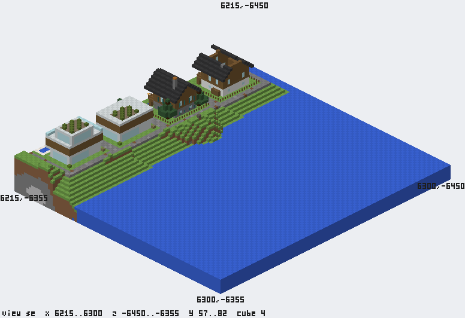

Numbers from the simulation on the river valley (70 plots, only the interior of the 17×17 lot is counted, the 8-block apron around it is not included):

| | cut | fill | max cut | max fill |
|---|---|---|---|---|
| current rule (±1 to neighbors, ±12 to base) | 382 317 | 42 | 42 | 1 |
| adaptive plans | 10 522 | 14 436 | 8 | 3 |

## 2. Terrain scan (`bridge/terrain-scan.mjs`)

### 2.1 Column

`TerrainScanner(worldDir).scan(rect)` returns per-column arrays:

- `ground`: natural ground height. Leaves and logs (a tree is the `TREE` flag, not ground), grass, flowers, snow layers and vines are skipped. Our pavement lies on the ground and counts as surface; house roofs and walls do not (flag `BUILT`).
- `water` and `depth`: water level and the number of water blocks (water, seagrass/kelp, bubble column; ice over water sets the `FROZEN` flag).
- `canopy`: top of the tree. `kind`: material (`grass`, `sand`, `stone`, `snow`, `built`, etc.). `biome`: biome at surface level, from `sections[].biomes`.
- `flags`: `PROTO` if the chunk is not yet `full`; `NO_TREES_YET` if its status is below `features`.

Derived data is built by `analyze(grid)`:

- `slope`: gradient over the surface smoothed with a 3×3 window.
- `step`: the largest drop to a neighbor in the 4 directions; a cliff is ≥3.
- Water bodies: 4-connected components. Type: `ocean` at ≥30% ocean biomes, `river` at ≥30% river biomes, `swamp` at ≥50% swamp biomes, otherwise `lake` (more than 80 columns) or `pond`. The type of an individual column is taken from its biome first, so an estuary stays sea and a river stays river.
- `shore`: distance from land to water. `offshore`: distance from water to the shore, half the width of the water body.
- Water in our own blocks (the fountain on the square) does not count as a water body.

**Robustness while the server is running.** Only the region header (8 KiB) and the sectors of the needed chunks are read, without `readFileSync` of the whole `.mca`. A corrupt chunk is re-read up to three times with a 40–120 ms pause. If that fails, the last good copy or "unknown" is used. The per-chunk cache is validated by the timestamp and offset from the header, so after `save-all` only what changed is decoded. Test: 12 scans of 1024 chunks in parallel with `save-all flush` passed without a single error.

**Proto-chunks.** In the test world a third of the chunks are not `full` (statuses `carvers`, `biomes`, `initialize_light`…). Heights are correct from status `noise` on, surface material from `surface`, trees from `features`. Below `noise` a column is treated as unknown (gray cells in the images).

### 2.2 The 21×21 cell

`classifyCells(an, { origin: [cx, cz] })` builds cells on the same grid as `plotRect` in `city.mjs`. Cell metrics: fractions of water, forest, built-up, sand and snow; a least-squares plane (slope and aspect); `relief` (p95−p5); fractions of steep and cliff columns; sides facing the water; max depth. Plus a platform plan for the 17×17 lot (§3.2).

| Class | Rule (in order) | Usage (`use`) |
|---|---|---|
| `unknown` | >30% of columns not generated | `scan-again` |
| `built` | ≥35% of columns are ours (streets, houses) | `occupied` |
| `river_crossing` | the river enters and exits through opposite edges, banks on the other two, width ≤ ~16; or a river cell with land on both sides | `bridge`, at relief ≥12 `viaduct` |
| `water` | ≥65% water | `open-water` (depth ≥3), `shallows`, `river` |
| `shoreline` | ≥6% water, or ≥8% of columns within 3 blocks of water, or neighbor of a water cell | `beach` (≥25% sand, gentle), `cliff-shore` (relief ≥8), `waterfront`, `riverside` |
| `cliff` | ≥8% of columns with a drop ≥3, or relief ≥14 | `natural` (lookout, trail) |
| `steep` | slope ≥0.33, or relief ≥9, or ≥20% of columns steeper than 45° | plan: `terrace2/3`, `walkout`, `stilts`, `natural` |
| `gentle` | slope ≥0.10 or relief ≥4 | usually `level` or `walkout` |
| `flat` | everything else | `level` |
| `forest` | `flat` or `gentle` with ≥45% of columns under trees | `park`; a house in a clearing costs more |

Additionally computed: `harbourScore` of shore cells (depth ≥3 in the neighboring lake or sea cell), `harbourSites()` (greedy selection of the best spots, no closer than 5 cells to each other, closer to the center, on a gentle shore), `siteScore()` (town site scoring) and `simulateGrowth()` (prototype of the new `nextCell`).

### 2.3 Images

Test town (center 6096,-6412). White `u` are already built-up cells, yellow `b wf/be` are shore, light-blue frames are harbour sites. The town sits on a peninsula, and the eastern plots were filled out into the sea.

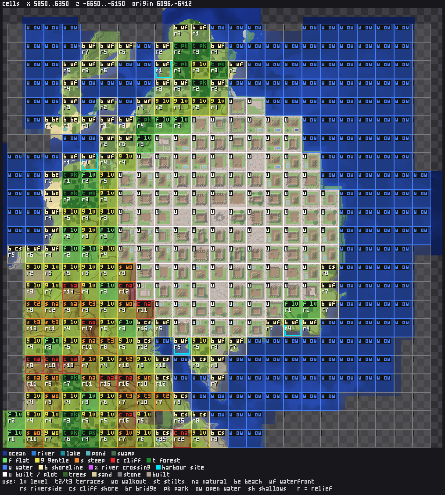

River valley with hills and lakes (x 5890..6330, z -5640..-5240): a "Swiss-style" candidate. Classes:

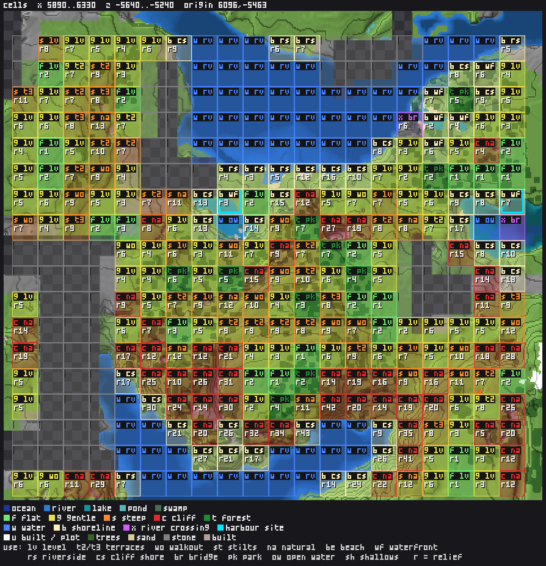

Growth simulation for 70 houses starting from the shore. The town climbs in terraces from y=63 at the water to y=111 on the plateau: 47 `level` plots, 11 `terrace2`, 9 `walkout`, 2 `st` staircases across steep cells, 11 `vp` lookouts, 3 parks.

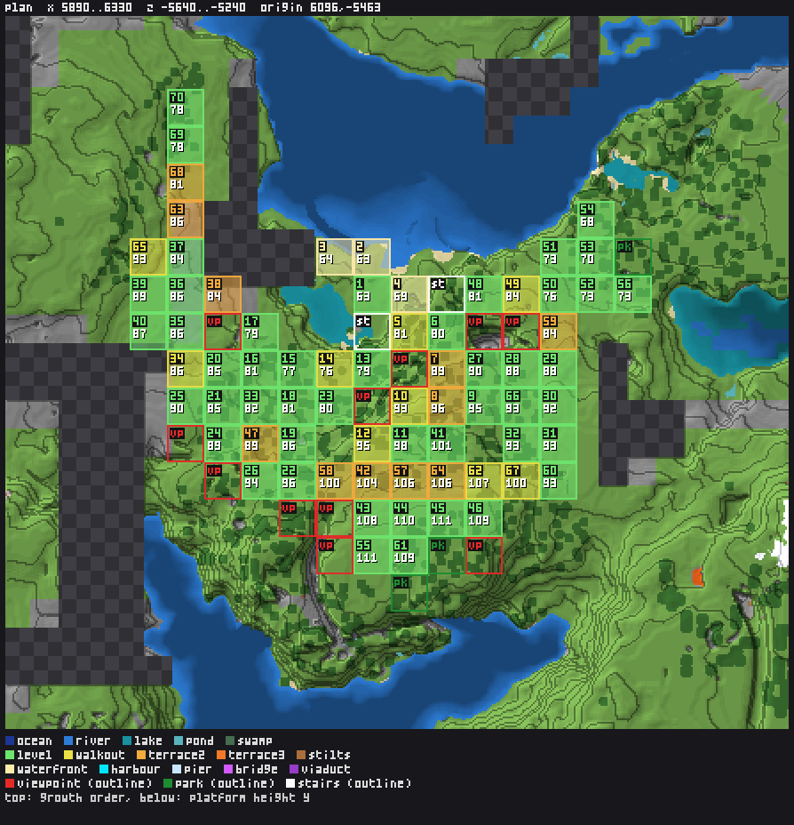

Per-column slope (`--view slope`): 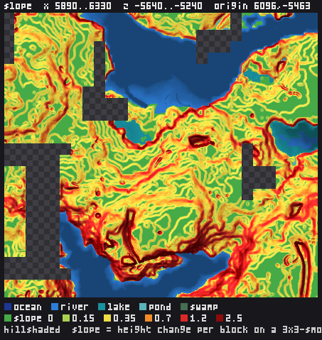

Live town (`server/world`, read-only): at the eastern edge, in cell [3,-1] (≈ -959, 1001), there is room for a harbour. This is a migration candidate (§9).

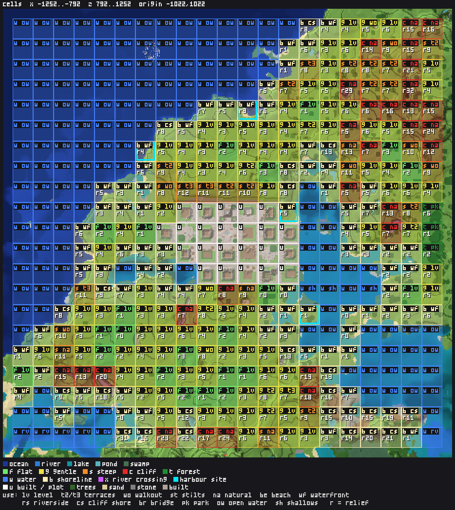

## 3. Hills

### 3.1 Budget

- Inside the lot: cut ≤3 and fill ≤3 per column (the `budget` parameter). The apron around the lot is ≤2 blocks instead of 8. Air is not cleared above the `terrain + budget` level.
- Trees outside the lot are left alone. Inside the lot only those that intersect the house volume are removed.
- The slope beyond the lot stays natural. If the drop to it is more than 3, a stone retaining wall is placed (`stone_bricks`, `mossy_stone_bricks`, `cobblestone` with `moss_carpet` and flowers on top) instead of an 8-block 1:1 embankment.

### 3.2 Platform plan (`platformPlan`)

Options are tried from cheapest to most expensive, all within the budget:

```
level      ▁▁▁▁▁▁▁▁▁        one platform: lot relief ≤ 2·budget (≤6)
terrace2   ▁▁▁▁▁            two platforms across the slope (by aspect), step ≤6,
               ▔▔▔▔▔        retaining wall between them; house on the upper one, garden on the lower
terrace3   three strips, same thing
walkout        ┌───┐        relief ≤ 2·budget+4: entrance from the upper street, basement/cellar
           ┌───┤   │        opens downhill (Keller, garage, workshop)
           ╱▔▔▔▔▔▔▔▔╲
stilts     ┌───────┐        floor at p85 level, cut ≤ budget, piles/posts under the floor
           ║  ║  ║ ║        down to the ground (≤9 blocks): Walliser Stadel, Pfahlbau
         ╱▔╱▔▔╲▔▔▔╲
natural    nothing is built: trail, bench, lookout
```

For stairs and steps the aspect is converted into rotations (`turns`): the house faces its entrance toward the upper street, and the basement looks downhill.

### 3.3 Seams between plots

Neighbors no longer dictate the height. The seam is chosen by |dy| between the street levels (the 2-block ring along the cell edge):

| |dy| | Seam | What gets built |
|---|---|---|
| 0–1 | step | as now: one row of stairs |
| 2–4 | staircase + wall | a row of stairs across the full street width, a retaining wall at the upper edge, flower tubs |
| 5–8 | Treppengasse | a solid retaining wall along the whole side. The flight of stairs runs **along** the wall, with a landing in the middle, and does not block the street. Railing, lantern |
| 9+ | no connection | a wall with a garden on top. The pedestrian link goes through the neighboring cell or a serpentine stair cell |

Distribution in the valley simulation (92 seams): 0–1: 27, 2: 14, 3–4: 27, 5–8: 19, 9+: 5. The current `seamCommands` covers only the first two rows; a seam generator is needed (§8).

### 3.4 Streets along contour lines

- **In the current grid.** The ring street runs at platform level. The side perpendicular to the contour lines turns into a staircase (seam). Across the slope, where |dy| is large, the street does not continue, and the connection goes to the neighboring cell along the contour line. The result is terraced streets with stair alleys.
- **Serpentine.** If a steep cell (`steep`/`cliff`) cannot be built on but there is a buildable one beyond it, it becomes a `stairs` cell: a zigzag of 4–5-block stair runs, turns with landings, retaining walls, lanterns. In the simulation such cells are marked `st`.
- **Later (major redesign).** Contour-following districts: rows of cells are shifted by half a cell along the contour line, and streets are built as a graph along contour lines, without a fixed ring. Not recommended now: it breaks `cellKey`, `plotRect`, PostAuto and routes.

### 3.5 Cliffs and steep slopes

`cliff` and `natural` cells are never built on. If such a cell borders the town, a lookout platform appears on its edge: a cantilevered wooden deck, railing, bench, Swiss flag, a telescope (`spyglass` in an `item_display`), a sign with the peak name from `bridge/peaks.mjs`. A trail of `dirt_path` and steps leads to it.

## 4. Water

### 4.1 Do not fill in

- In `preparePlot` fill goes only over `air` and plants; water is left untouched: either our own block tag in the datapack (`#alps:fillable` = air + plants) or two commands `fill … replace air` / `replace #minecraft:flowers`.
- `water` cells never become houses. The part of a lot that is over water (at a shore cell) stands on stilts or a pier, not on an embankment.

### 4.2 Shore cells

| use | What gets built |
|---|---|
| `beach` | Beach and "Badi" (Swiss lido): sand, parasols (a banner on a fence), deckchairs (stairs, carpets), changing cabins, a diving tower on a boardwalk, boats on the sand |
| `waterfront` | Promenade (Quai): 3–4 blocks of stone paving along the water, a `stone_bricks` quay wall down to the bottom or 3 blocks deep, a row of linden trees, lanterns, benches, railing, steps down to the water; houses behind the promenade |
| `riverside` | A narrow promenade, stairs down to the water, a boardwalk for washing and boats |
| `cliff-shore` | A restaurant terrace above the water, stairs down to a jetty below, vineyard terraces (Lavaux) |

A house on a shore cell stands on dry land. The promenade runs along the side facing the water (`edgesToWater`). If land covers less than 60% of the lot, the rest stands on stilts.

### 4.3 Piers

For each water cell in front of a `waterfront`/`beach` with depth ≥2:

- a 2–3-wide deck of `spruce_slab` on fence posts down to the bottom (the bottom is known from the scan), extending until depth ≥3, but no farther than 12 blocks;
- a lantern at the end, mooring bollards (`polished_andesite_wall`, chain);
- 1–3 boats (`oak_boat`, `spruce_boat`) at the pier. Boats drift with the current, so only in still water; in a river they could be tied with a lead (in 1.21.2+ boats can apparently be leashed — to verify).

### 4.4 Harbour

The site is chosen by `harbourSites`: a shore cell next to a lake or sea (not a river, not a pond) with depth ≥3, closer to the center, on a gentle shore, one per district or per 5 cells. Composition (1–3 cells):

```
        ~~~~~~~~~~~~~~~~~~~~~~~~~~~
        ~~  ▓▓▓▓▓▓▓▓▓▓▓▓▓▓▓▓▲ ~~~~~   ▓ breakwater (stone_bricks / cobblestone wall), ▲ lighthouse at the head
        ~~  ▓  ⛵   ⛵      ▓ ~~~~~   ⛵ boats, ⛴ steamer at the jetty
        ~~  ▓    ⛴═════     ▓ ~~~~~   ═ Schiffstation jetty
        ════╧══════════╧═════╧════   ─ quay wall
        [Bootshaus][Schiffstation⌚][Fisch]   houses on the shore; ⌚ SBB clock (feature clocks)
```

- The stone breakwater is placed in the water. This is not filling in: a narrow 2–3-block wall, the water behind it remains.
- A lighthouse at the head of the breakwater. On a lake it is a small red-and-white lighthouse, as in Romanshorn or Brunnen; on the sea a tall one. At night its lamp is lit (feature night).
- Bootshaus: a wooden boathouse on stilts with water inside and a boat.
- Schiffstation: a pavilion with an SBB clock (reuse `clocks.mjs`) and an "Abfahrt" sign.
- Crane, nets, barrels, a fish stall.

### 4.5 Ships

- **Boats**: real `boat` entities (Invulnerable, PersistenceRequired). A fisherman is a villager with the `fisherman` profession in a boat (NoAI). The fishing rod is an `item_display`.
- **Sailboats**: a composite `block_display`: hull of stairs and slabs, a sail of `white_wool` at scale 0.1. They slowly circle on the water.
- **Lake steamer** (DS "Stadt Luzern"): a composite `block_display`. White hull, two decks, a yellow funnel, paddle wheels in housings on both sides, a flag at the stern. About 15 displays as "passengers" of a single `item_display` root, like the allay in `life.mjs`. Movement: `tp` of the root with `teleport_duration` along route waypoints, like PostAuto in `work.mjs`; turning via yaw. The wheels rotate via `left_rotation` interpolation, like the clock hands. The route is A* over water columns with `offshore ≥4` and `depth ≥3` between jetties. Schedule: departure every hour by the SBB clock, a 20 s stop at the jetty. The steamer runs only while a player is within ~160 blocks: the chunks must be loaded, and commands are not free.

### 4.6 Bridges

`river_crossing` is not a house plot but a public structure; it is built by idle builders ("Chat economy" → public works).

| Width / relief | Type |
|---|---|
| ≤12 | single-span stone arch bridge, `stone_bricks` + `stone_brick_stairs` along the arch, `stone_brick_wall` railing |
| 13–30 | covered wooden bridge like the Kapellbrücke: `spruce_planks` deck, `spruce_stairs` roof, flower boxes on the railings, an octagonal Wasserturm tower on a stone pier in the middle; or a multi-span stone bridge |
| relief ≥12 (gorge) | a viaduct like the Landwasser: tall stone arches down to the bottom; a "train" can run across it (block_display, like PostAuto) |

Deck height = the maximum of the street levels on both banks + ramp. Piers go down to the bottom, the water between them is left untouched. The bridge axis follows the "bank → bank" direction from `river_crossing`.

### 4.7 Waterside districts

- A shore cell gets a `waterfront` zone modifier on top of the ring zone (core/inner/outer/rural). `pickType` adds weights from `CATALOG[type].terrain` (§7). The grand hotel prefers water, as in Montreux and Vitznau.
- A district square (`plaza`), if the district touches the water, is placed on the shore as a Seeplatz with a jetty.
- A district's first jetty is "Schiffstation <district>". The steamer connects districts on the same body of water.

## 5. Forests

- Trees around a plot are no longer cleared (§3.1).
- A `forest` cell is expensive but allowed: a house in a clearing, trees outside the house footprint remain (`Waldhaus`, hut). If a district is surrounded by forest, a park appears at the forest edge: benches, a path, a fire pit.
- Continuous stretches of forest cells between districts are not built on; they are the town's green wedges.

## 6. How to fit this into the grid and district model

### 6.1 Minimal changes (recommended)

| Now | Becomes |
|---|---|
| `nextCell` chooses by `hypot(c) + dist(seed)·0.8` | the same + `cost(cell)`: `level` 0, `walkout` 0.8, `terrace2` 1.2, `terrace3` 2, `stilts` 2.5, shore 0.4, forest +1.5, bridge 3; ∞ for `water`/`cliff`/`unknown`/`built`; a stair cell acts as a passage (§3.4). Prototype: `simulateGrowth` |
| `plotGround` (spreadplayers probes, ±1/±12 clamp) | `terrain.cellPlan(cell)` from the scan: levels, mode, aspect, water sides. No clamp |
| `preparePlot(r, y)` | `prepareAdaptive(plot)`: budget, terraces, retaining walls, stilts, no water filling, apron ≤2 |
| `stitchSeam` (|dy| ≤2) | `seamBuilder(dy)` per the table in §3.3 |
| `pickType(zone)` | `pickType(zone, terrain)`: weights `CATALOG[type].terrain[cls]` and an `options.terrain` variant for the generator |
| `districtSeed` (golden angle) | the same ray, but the first suitable cell is not `water`/`cliff`, preferably with water nearby |

`plot` gets a new field `terrain: { mode, levels, aspect, waterSides, scanVersion }`. Old plots without this field are built as before.

### 6.2 Major redesign (later)

Contour-following districts, a street graph, irregularly shaped plots. Needed only if the 21×21 grid becomes a bottleneck. PostAuto, villagers (`life.mjs`) and seams would be reworked at the same time.

### 6.3 Site selection (`findValley` v2)

1. Candidates: `locate biome` as now, plus `river`, `meadow`, `cherry_grove`, `stony_shore`. Only candidates with `#is_mountain` or `windswept_hills` within 300 blocks are considered.
2. A 13×13-cell window (≈270×270 blocks) around the candidate: `forceload add` with at most 256 chunks per command, wait for status ≥`noise` on disk (enough for heights; trees are not needed), `save-all`, scan.
3. `siteScore` (lower is better): a buildable core r≤2, water (lake/river/bay) within 6 cells, ≥8 shore cells, 1–3 harbour sites, hills on the 6–10-cell ring (relief), few cliffs in the core, no water at the center. The prototype already computes this: the valley at 6096,-5463 scored −26, the test town −49, the live town −90.
4. Then `forceload remove`. Generating 300–900 chunks on Paper takes ≈10–40 s, a one-time cost when founding a town.

## 7. New building types and variants (for the architect)

The generator receives `options.terrain = { mode, levels:[…], turnsDownhill, waterSides:[…] }` and builds a variant. Determinism and stages follow `docs/generator-contract.md`: all `rng` decisions are made before rendering, and the variant affects only the basement and supports.

| Type / variant | Mode | Summary |
|---|---|---|
| `chalet`, `townhouse`, `farmhouse` · **walkout** | `walkout` | a stone basement storey further down the slope: cellar, workshop, garage with a gate; entrance from above; a balcony over the basement |
| `chalet`, `hut` · **stilts** | `stilts` | floor at p85 level, `spruce_log`/stone piles below it down to the ground, stairs to the entrance; Stadel "mushrooms" (`stone_slab` on posts) |
| `terrace_house` (Reihenhaus) | `terrace2/3` | 2–3 sections, each on its own platform, a shared stepped roof |
| `vineyard` | `terrace2/3`, `cliff-shore` | retaining walls, vines (`cave_vines`/`sweet_berry_bush` on trellises), a winemaker's cottage (Lavaux) |
| `boathouse` (Bootshaus) | shore | a wooden house on stilts, water inside, a boat, a gate to the water |
| `lido` (Badi) | `beach` | changing cabins, boardwalk, diving tower, café kiosk |
| `schiffstation` | harbour / jetty | pavilion, SBB clock, departure board, jetty |
| `lighthouse` | breakwater head | 1×1–3×3 tower, lamp, red-and-white stripes (`red_concrete`/`white_concrete`) |
| `seevilla` | `waterfront` | a villa with a garden down to the water and a small jetty |
| `lake_hotel` | `waterfront` | a `hotel` variant with a promenade terrace |
| `fish_stall`, `harbour_crane` | harbour | small forms (`smallforms.mjs`) |
| `bridge_arch`, `bridge_covered`, `viaduct` | `river_crossing` | §4.6; not plots but objects of length N |
| `viewpoint`, `stair_lane` | `cliff`/`steep` | lookout, serpentine stair cell |

Weights live in `CATALOG[type].terrain`, e.g. `boathouse: { terrain: { shoreline: 4 } }`, `chalet: { terrain: { steep: 2, gentle: 1 } }`.

## 8. What is needed from the bridge (API)

```js
// terrain-scan (a single instance in the bridge, world = config.serverDir/<level-name>)
scanner.scan(rect) / analyze(grid) / classifyCells(an, { origin })   // exists in the prototype
terrain.refresh(rect)            // `save-all flush` (at most once every N minutes) + rescan of changed chunks
terrain.cellInfo(cell)           // class, use, plan, water sides; cached on state.city
terrain.ensureGenerated(rect)    // forceload + wait for status ≥ noise (for findValley and the town edge)

// planner
nextCell(state, district, terrainCost)       // §6.1
cellPlan(cell) -> { mode, levels, aspect, waterSides }
seamCommands(plot, neighbour, dir)           // by |dy| (§3.3), idempotent, respects STREET_VERSION
prepareAdaptive(plot, plan)                  // budget, walls, stilts, no water filling
waterworks: piers(cell), quay(edge), harbour(site), bridge(crossing)   // objects like the "Economy" forms
fleet feature: boats/steamer/sailboats       // bridge/features/fleet.mjs, onTick + players nearby
```

Data: `state.city.terrain = { scanVersion, harbourSites:[…], bridges:[…] }`, `plot.terrain`. Freshness: nature does not change on its own, so the per-cell scan cache stays valid until we build nearby. We already know about our own changes from `state`.

## 9. Migrating existing towns

- **Never demolish.** Old plots keep their `y`, new ones get plans. The seam between old and new is built by |dy| (§3.3).
- **New plots** follow the new rules as soon as Phase 1 lands: the town stops growing into the water and cutting slopes.
- **Shore renovation** (the renovation crew, additive only):
  - if an old plot borders water, the lawn embankment into the water is faced with a `stone_bricks` quay wall: only `grass_block`/`dirt` on the embankment is replaced, the water is untouched;
  - railings, lanterns and benches appear on the water side of the ring street;
  - a pier is placed in the water cell in front of the plot (the water stays, only posts and deck are placed);
  - a harbour grows at the best site from `harbourSites`. In the live town that is cell [3,-1] (≈ -959, 1001), right at the eastern edge; in the test town it is [4,6] (≈ 6180,-6286).
- Bridges and the steamer are new objects and do not touch old houses.

## 10. Implementation plan

| Phase | What | Estimate | Value |
|---|---|---|---|
| **0. Stop the damage** | `preparePlot`: fill only over air and plants (water is not filled in); apron 8 → 3, `clearAir` no higher than `top+2`; leave surrounding trees alone; `nextCell` skips cells where the probe found water | 0.5 day | high, low risk |
| **1. Scan in the bridge** | `terrain-scan` in `bridge`; `cellInfo` for `nextCell` (cost, ban on water and cliffs); plot height from the `level` plan without the ±1/±12 clamp; `plot.terrain`; 2–4 seams with a wall | 2–3 days | high |
| **2. Slopes** | `prepareAdaptive`: terraces, retaining walls with gardens, stilts; 5–8 (Treppengasse) and 9+ seams; stair cells; `walkout`/`stilts` generator variants (architect) | 4–6 days | high, immediately visible |
| **3. Shore** | promenade, beach/Badi, piers with boats, harbour (breakwater, lighthouse, Bootshaus, Schiffstation); shore renovation of old towns | 4–5 days | high |
| **4. Bridges and fleet** | three bridge types as public works; `fleet` feature: boats, sailboats, scheduled steamer | 4–6 days | medium–high, "wow" |
| **5. Site selection** | `findValley` v2: candidates, `ensureGenerated`, `siteScore` | 2 days | new towns only |

**Recommended first phase: 0 + 1 together (≈3 days).** Phase 0 immediately stops filling in the sea and shaving off slopes. Phase 1 gives the planner eyes: the scan already works, it only needs to be wired into `nextCell` and `plotGround`.

### Cheap and expensive

| Cheap | Expensive |
|---|---|
| disk scan (0.5 s per 500×500, 40 ms on repeat) | `save-all flush` (≈1 s, server I/O): at most once every few minutes, only before founding a district or an edge plot |
| classes, plans, cell costs | chunk generation via `forceload` for a new site (10–40 s) |
| no water filling, apron, walls | variant generators (`walkout`, `stilts`) and new types: architect's work |
| piers, promenade, boats | steamer: ~15 displays + a `tp` every 1–3 s, only with a player nearby |
| | bridges of length N (own generator, seam to the streets on both banks) |

### Risks

- **Reading region files while they are being written.** Solved with partial reads, retries and a timestamp-based cache (verified under `save-all`). Data on disk lags behind the world until `save-all`, but nature does not change on its own, and we know our own changes.
- **Ungenerated chunks** at the town edge. `unknown` cells are not allocated. Before growing toward the edge: `ensureGenerated` (forceload, wait for status ≥ noise).
- **Proto-chunks.** Heights are correct, but trees and material may be missing (`NO_TREES_YET`): forest on such cells is underestimated. "Forest / not forest" decisions need status ≥ `features`.
- **Class thresholds** were tuned on three sites (test town, river valley, live town). They need checking in mountains (`jagged_peaks`, gorges); they are changed in one place.
- **Walkability.** Staircases, Treppengasse and stilts need to be run through `tools/walkcheck.mjs` (entry from the street), and we need to verify that villagers (`life.mjs`) and PostAuto (route along the rings) do not get stuck. PostAuto does not drive on stairs: seams ≥2 need a stop or a detour.
- **Entities.** Boats drift with the current; the steamer and sailboats cost chunk loading and commands. The fleet runs only with a player nearby, boats only in still water.
- **Generator contract.** Variants must be deterministic and compatible with stages. Old generators ignore new fields in `options`, so the bridge must be able to add stilts and a basement on its own (as `yardExtras` does now).

---

## 11. Implementation (phases 1–5), October 2026

*This section is in English; the design above is the original plan.*

### 11.1 Switches

| Feature id | What it does | Files |
|---|---|---|
| `adaptive-terrain` | Scan-driven planning for new plots (cost per cell, level from the scan, earthwork budget, seams by height difference), stair lanes, viewpoints, scan-based site selection for a new city | `bridge/terrain.mjs` (`TerrainPlanner`), `bridge/city.mjs` (`nextCell`, `districtSeed`, `pickType`), plot code in `bridge/bridge.mjs` |
| `waterfront` | Quays, jetties, promenade, lido beach, harbour | `bridge/infra.mjs` |
| `river-bridges` | Bridges over rivers (stone arch, covered wooden bridge with a water tower, viaduct) | `bridge/infra.mjs` |
| `shore-renovation` | Additive migration of existing plots: quays where grass slopes meet water, a jetty, the harbour | `bridge/infra.mjs` (`planShoreRenovation`) |

All four are in `TESTED` (verified on the test server), so the `basic` preset enables them. Old plots are never rebuilt: `plot.terrain` exists only on plots created under the new rules.

### 11.2 How a new plot is made

1. **Survey.** Before `nextCell`, the frontier of the district (neighbours and cells two away) is generated if needed (`ensureGenerated`: force-load through the shared `ChunkLoader`, wait for `execute if loaded`, release — Paper writes chunks on unload; `save-all flush` only if that was not enough, at most every 2 minutes) and the town area is rescanned from the region files (cached per chunk; a 500×500 area costs about 0.5 s, a rescan mostly reads headers).
2. **Cost.** `nextCell(state, district, terrain)`: distance score + 1.6 × cost. Cost from the lot plan: level 0, terrace 0.8, walkout 1.4, stilts 2.4, +1.2 in a forest, −0.3 on a dry shore lot; `Infinity` for water, cliffs, unknown, built, river cells and cells reserved for infrastructure. If a neighbour is unbuildable but steep or a cliff (stair lane) or a river cell (bridge), the cell behind it is a candidate too (+4 / +6) and the crossing is built.
3. **Level.** `lotPlan(cell, neighbours)` tries every street level between p2 and p98 of the lot's ground (never below the water next to it) and minimises `cut·1.3 + fill + 25·(cut deeper than 3) + 0.8·(fill deeper than 3) + seam penalty` (a level matching a neighbour saves a seam). No clamp to the neighbours or to the city base. Mode by the remaining drop: `level` ≤ 3, `terrace` ≤ 5, `walkout` ≤ 8, `stilts` ≤ 14, else not buildable.
4. **Preparation** (`adaptiveOps`, about 70–600 commands per lot, merged into `fill` rows): trees and ground above the level are cut only inside the lot; ground below is filled with dirt, except on the lot edge where a drop of 3+ becomes a rubble retaining wall (stone bricks, mossy bricks, cobble) with a `stone_brick_wall` railing on sides without a neighbour; `stilts` lots get a plank deck on spruce log posts where the ground is deeper than 3; water columns are **never filled**: a quay wall on the outer row (≤ 4 above the water), a plank deck on waterlogged fence posts elsewhere. Around the lot a 2-block apron eases slopes of ≤ 3; a deeper uphill cut is faced with a wall. `walkout`/`terrace` lots get a vaulted cellar with a door in the tallest stretch of the downhill wall, unless the generator builds the variant itself (`TERRAIN_VARIANTS`, see `docs/generator-contract.md` §7).
5. **Seams** (`seamCommands`, versioned by `STREET_VERSION`, re-applied by renovation): |dy| 1–2 as before; 3–4 a flight across the street with a retaining wall (for 4 the upper edge row becomes a step too); 5–8 a wall along the whole edge with a railing and a Treppengasse along its foot (one flight, a landing half way, a lantern); 9+ wall, railing with flower pots, ivy. Lot railings on a shared edge are taken down.
6. **Infrastructure** around the plot (`planAfterPlot`): a quay on every side with water within 3 blocks (railing of iron bars, lamps every 6, benches facing the water, a ladder, or a stepped stone bank with a flight of steps down to the water where a grass slope runs into it); a jetty into lakes and the sea (never rivers) out to depth ≥ 3, max 12 long, with steps down from the quay, lanterns and moored boats; a promenade or a lido on shore cells too wet for a house (sand, parasols made of banners on fences, towels, deck chairs, a row of changing cabins with a Swiss flag, boats pulled up, a diving jetty with a tower); a viewpoint on cliff cells next to the town (plank deck on posts at street level, or a stair up to the top; railing, bench, flag, spyglass, sign); bridges and stair lanes where two town plots face each other across one river or steep cell; the harbour once (≥ 4 plots) at the best bay within 2 cells of the town: an L-shaped breakwater with lamps, a red-and-white lighthouse on its head, a steamer landing inside, moored boats. The bay must belong to a lake or sea of ≥ 2500 columns and have an open mouth.
7. **Crew.** Infrastructure is built by `InfraWorks` (`infraBlocksPerSecond`, default 4, while a chat works), one piece at a time; anchors for boats and steamers are published in `state.terrain.anchors` (`docs/world-anchors.md`). When `bridge/infra.mjs` changes (`INFRA_VERSION`), finished pieces are re-applied additively (no clearing, no new entities). The crew re-asserts the bridge's force-loads when another process dropped them (`ChunkLoader.verify`).

### 11.3 Site selection for a new city (phase 5)

`TerrainPlanner.findSite`: candidates from `locate biome` (river, meadow, plains, sunflower plains, cherry grove) on two rings around `searchOrigin`, hills first (distance to `#is_mountain` / `windswept_hills`); the 8 best are generated (about 380×380 each), scanned and scored by `siteScoreAt` for centres up to 3 cells off: a buildable core, lake > river > sea, harbour sites, mean relief on the ring 3–8 (hills), few cliffs in the core, no water in the centre. Falls back to the old probe-based `findValley`. On the test server (origin 0,40000) it surveyed 8 sites in about 2 minutes and chose a meadow at −739,38837 between two rivers with hills to the north (score −78.5; the runner-up −44).

### 11.4 Test evidence (shared test server, 25.10.2026)

**Town 1** (new rules from the start, 196 plots grown by 9 simulated chats): the rivers on three sides untouched; terraced lots with rubble walls, stilt houses over the slopes, 10 stair lanes (straight and three-flight switchbacks), 7 viewpoints, 4 covered bridges with water towers, 68 quays, 12 promenades, 2 jetties, a lido beach, a harbour.

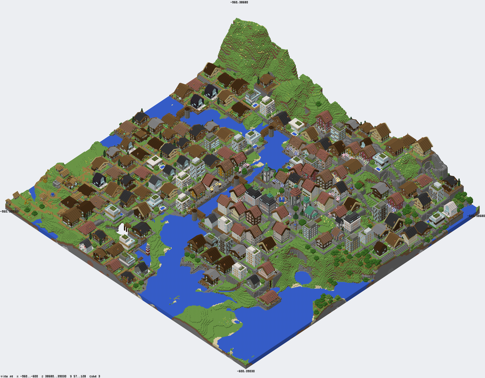

Terraces, walls and a stilt house on the west slope; the switchback lane (three flights, lamps at the landings) seen from above; a Treppengasse seam between the square and the clock tower plot (6 blocks):

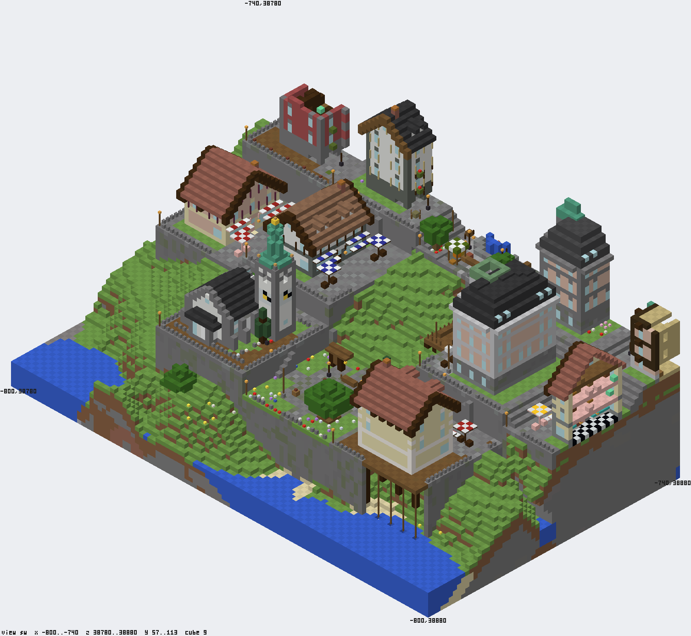 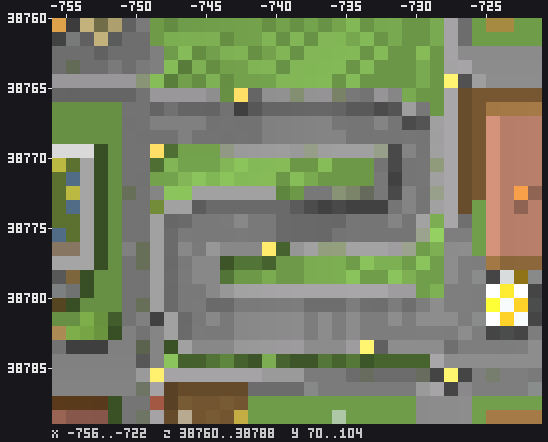 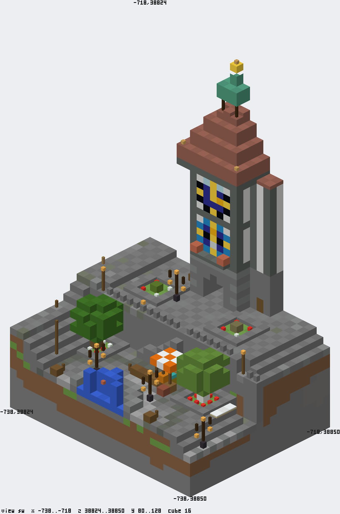

Covered bridge with the water tower, and the stone arch bridge (built with `.dev/terrain/bridgetest.mjs` on a narrower river: 965 blocks, 0 errors):

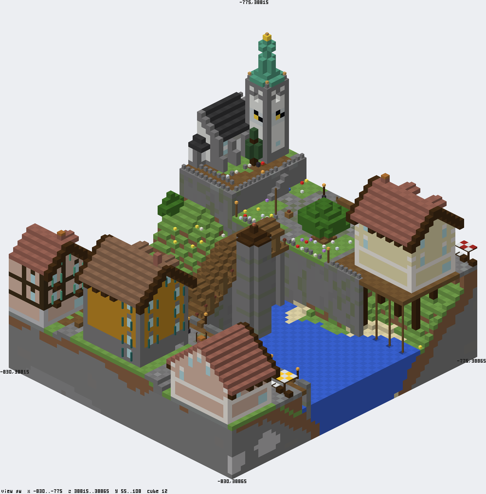 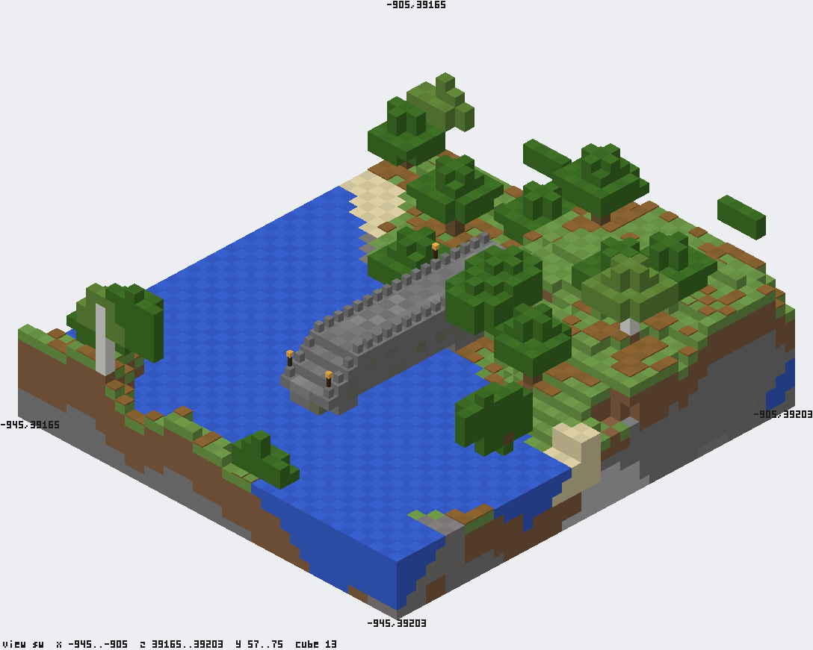

**Town 2** (migration test): 26 plots built with the old rules on a sea coast, then all four switches turned on live. Shore renovation planned 4 quays, a jetty and the harbour at once and the crew built them; new plots then followed the new rules (a `lido` building turned to the water, a beach, a promenade, a stair lane, a viewpoint).

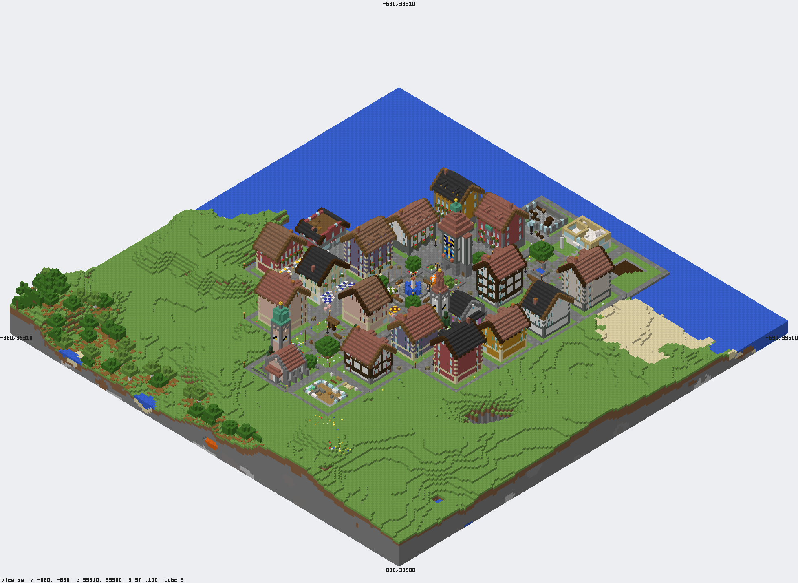 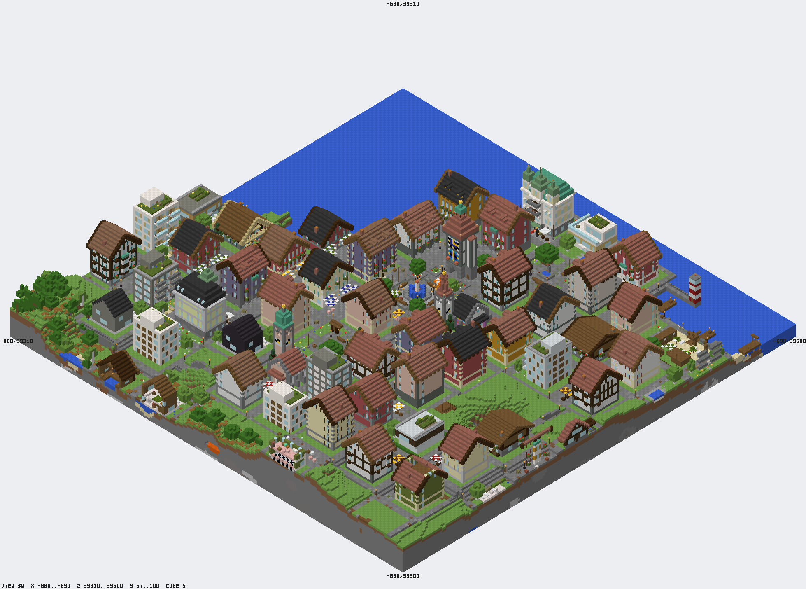

Stepped stone quay with lamps, benches and a jetty on the old plots; the coast with the harbour, the lido and the beach:

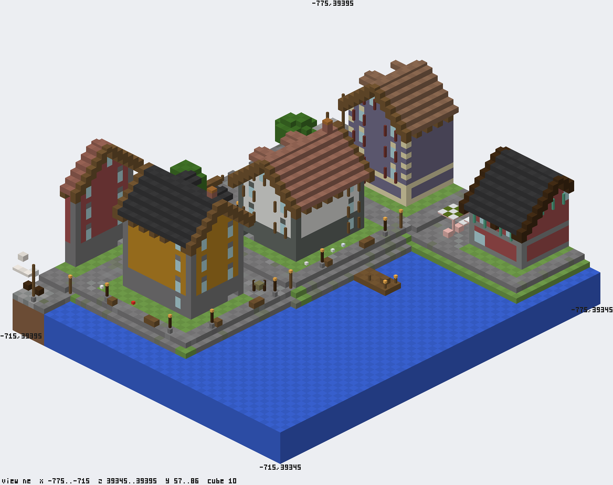 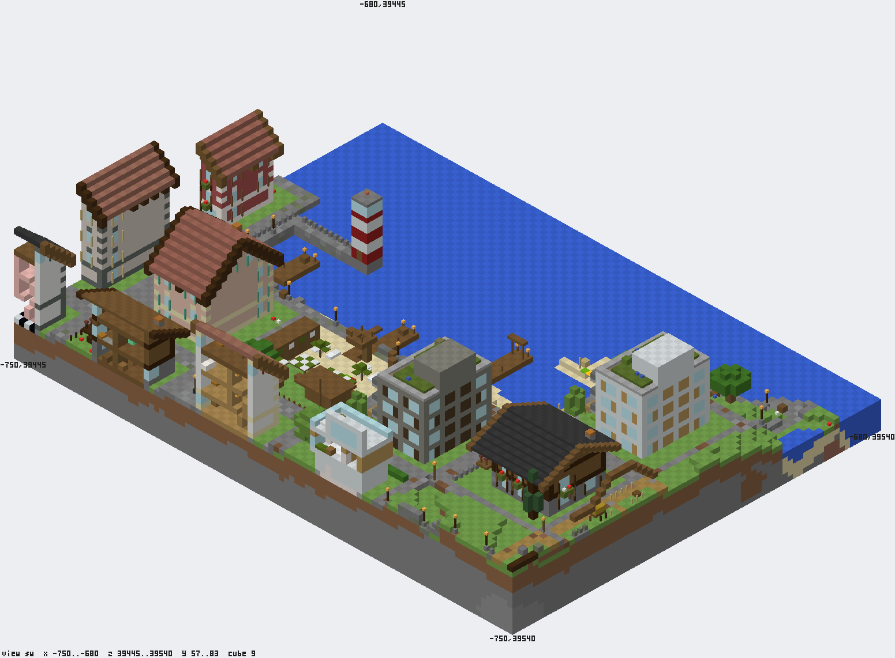

**Earthwork** (`node tools/terrain-report.mjs --state <state> --earthwork …`; "old rules" = the probe level clamped to ±1 of the neighbours and ±12 of the base, the lot levelled, 1:1 terraces 4 wide, computed on the same natural scan when the plot was created):

| Town | Plots | New rules: cut / fill / walls | Old rules: cut / fill (of it into water) |
|---|---|---|---|
| 1 (hills between rivers) | 183 | 29 320 / 45 956 / 17 414 | 40 229 / 840 507 (28 512) |
| 2 (coastal plain) | 40 | 6 651 / 3 431 / 1 036 | 41 936 / 2 174 (260) |

Water filled under the new rules: 0. Seam steps in town 1: 0–1: 111, 2–4: 113, 5–8: 46, 9+: 12. The old-rule numbers of town 1 are inflated for its first ~100 plots, whose old-rule clamp used the neighbours' new levels (fixed afterwards); town 2's are consistent.

All 74 385 block strings emitted by the infrastructure and the lot preparation validate against the 1.21.11 block report (`node .dev/terrain/validate-infra.mjs`).

### 11.5 The live city (dry run, read-only)

`node tools/terrain-report.mjs --world server/world --state <copy of state.json> --rect -1250,800,-800,1250 --migrate` plans for the live Promptenhorn (29 plots): quays on the east side of plots 3,0 and 3,−1 (stepped banks, street y=63, water y=62), a 6-block jetty from 3,0 into the lake, and the harbour in the lake bay at cell [5,4] (about −919, 1105; breakwater 52 columns, lighthouse, a 9-block steamer landing). The cell [3,−1] proposed in §2.3 has been built over since.


### 11.6 Not done / open

- Contour blocks (§6.2) and irregular plots: not started (the grid is kept on purpose).
- The fleet (moving boats, the steamer) belongs to the life agent; the anchors are ready.
- A generator lighthouse on the breakwater head (the bridge builds its own).
- PostAuto and residents do not know stairs and decks; lanes are not run through `tools/walkcheck.mjs` automatically.
- Viaducts are only chosen for gorges (relief ≥ 12 with deep water); none occurred in the tests, so that builder is untested in game.
